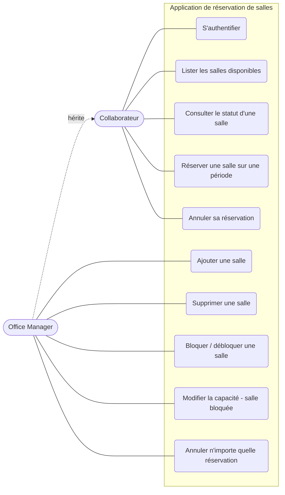
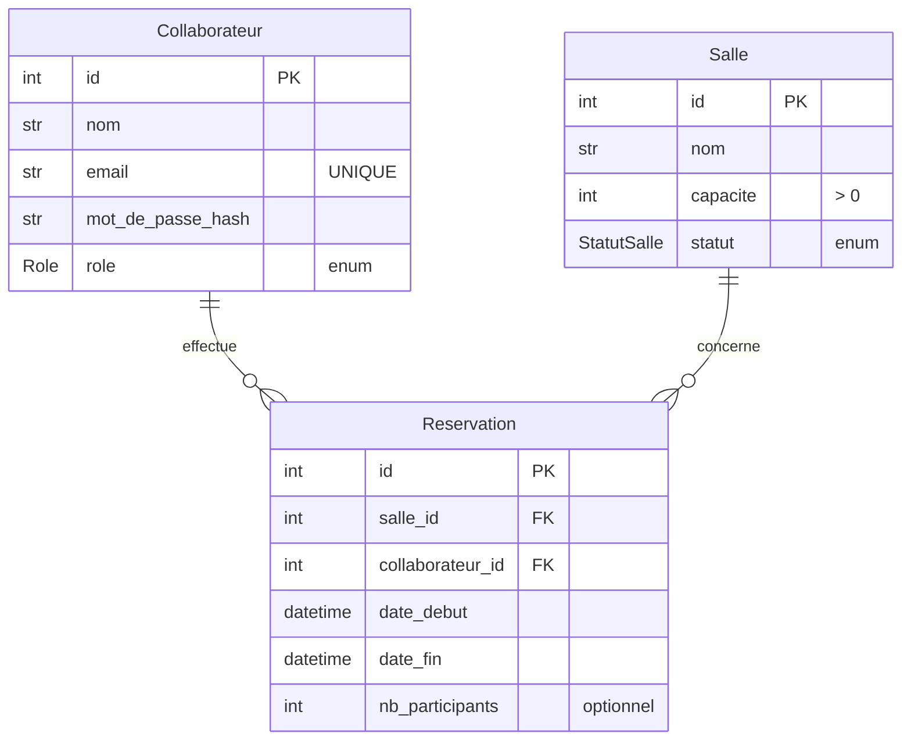
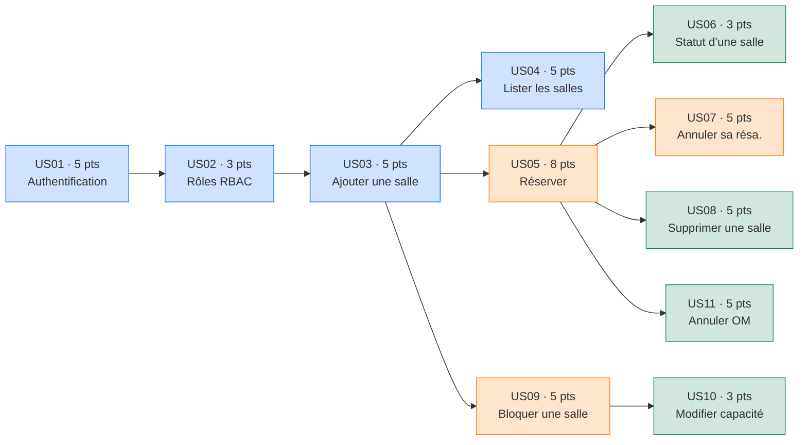
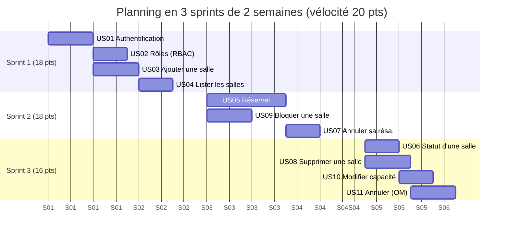

# TD 01 — Partie A : Avant-projet

Application de réservation de salles.

---

## 1. Cahier des charges

| Section | Contenu |
|---|---|
| **Contexte** | Les réservations se font sur papier, affiché sur la porte. On ne trouve pas les salles libres, des salles sont réservées mais restent vides, et on ne peut pas libérer une salle à distance. |
| **Objectifs** | Trouver plus facilement les salles disponibles, mieux les utiliser et pouvoir les gérer à distance. |
| **Acteurs** | Collaborateur ; Office Manager (a tous les droits du Collaborateur). |
| **Périmètre fonctionnel** | Use cases (§2) et user stories (§5). |
| **Règles de gestion** | Une réservation couvre une période [début, fin[ ; deux réservations d'une même salle ne se chevauchent pas ; une salle bloquée ne peut pas être réservée ; la capacité ne se modifie qu'après blocage de la salle ; un collaborateur n'annule que ses propres réservations. |
| **Contraintes techniques** | Python, FastAPI, SQLAlchemy (+ Alembic) ; image de conteneur (Dockerfile, Docker/Podman) ; une instance configurable par immeuble ; un test pour chaque fonctionnalité ; observabilité (`/health`, journaux). |
| **Livrables** | Cahier des charges, planning prévisionnel, dépôt Git, Dockerfile, pipeline GitLab CI. |
| **Risques** | Trois catégories, chacune avec un plan de mitigation (§3). |
| **Modèle de données** | Entités, attributs, relations et contraintes (§4). |

---

## 2. Use cases

| Id | Cas d'utilisation | Acteur | Remarque |
|---|---|---|---|
| UC01 | S'authentifier | Tous | À faire avant toute autre action. |
| UC02 | Lister les salles disponibles | Tous | Idéalement filtrable par créneau. |
| UC03 | Consulter le statut de réservation d'une salle | Tous | Réservations à venir de la salle. |
| UC04 | Réserver une salle sur une période | Tous | Vérifie le chevauchement et le blocage. |
| UC05 | Annuler sa réservation | Tous | Répond au besoin « libérer à distance ». |
| UC06 | Ajouter une salle (avec capacité) | Office Manager | Capacité fixée à la création. |
| UC07 | Supprimer une salle | Office Manager | Que faire des réservations futures ? |
| UC08 | Bloquer / débloquer une salle | Office Manager | Empêche temporairement de réserver. |
| UC09 | Modifier la capacité d'une salle | Office Manager | Seulement sur une salle bloquée. |
| UC10 | Annuler n'importe quelle réservation | Office Manager | Libère les salles « fantômes ». |

### Fiche détaillée — UC04 « Réserver une salle »

| Élément | Description |
|---|---|
| **Acteur** | Collaborateur (ou Office Manager) |
| **Préconditions** | L'utilisateur est authentifié ; la salle existe. |
| **Scénario nominal** | 1. L'utilisateur choisit une salle et une période (début, fin). 2. Le système vérifie que fin > début. 3. Le système vérifie que la salle n'est pas bloquée. 4. Le système vérifie qu'aucune réservation existante ne chevauche la période. 5. Le système enregistre la réservation au nom de l'utilisateur et la confirme (201). |
| **Scénarios alternatifs** | 2a. fin ≤ début → erreur de validation (422). 3a. Salle bloquée → refus (409). 4a. Créneau occupé → refus (409) ; le système peut proposer d'autres salles. Salle inexistante → 404. Utilisateur non authentifié → 401. |
| **Postconditions** | La salle est occupée sur la période ; l'événement est journalisé. |

---

## 3. Risques et mitigation

P / I : probabilité / impact — F = fort, M = moyen.

| Risque | P/I | Mitigation |
|---|---|---|
| **Conception & développement** | | |
| Double réservation (chevauchement, requêtes simultanées) | M/F | Règle de non-chevauchement vérifiée côté serveur + test dédié ; contrainte ou verrou en base si le SGBD est partagé. |
| Faille d'authentification (mots de passe en clair, jeton falsifiable) | M/F | Hash salé (PBKDF2, bcrypt, argon2) ; jeton signé avec un secret fourni par variable d'environnement ; HTTPS. |
| RBAC mal appliqué (route de gestion accessible à tous) | M/F | Dépendance FastAPI réutilisable ; tests 401 / 403 sur chaque route. |
| Dates et fuseaux horaires incohérents | M/M | Stockage en UTC, format ISO 8601, validation fin > début. |
| Évolution du schéma de base de données | F/M | Migrations Alembic versionnées et relues. |
| **Planification** | | |
| Sous-estimation (FastAPI n'a pas d'authentification intégrée, montée en compétence) | F/M | Planning poker, marge de risque, nouveau calcul de la vélocité après le sprint 1. |
| Dérive du périmètre (notifications, synchro agenda, badgeuse…) | M/M | Backlog priorisé avec le PO ; toute nouvelle demande passe par une change request. |
| Dépendance à l'équipe infrastructure (runners, registry, déploiement) | M/F | L'impliquer dès le sprint 1 ; livrer tôt une image conteneur pour valider le format. |
| Absence d'un membre de l'équipe | M/M | Revues de code croisées, pas de « propriétaire unique ». |
| **Maintenance** | | |
| Documentation insuffisante pour l'équipe de maintenance | M/F | README, Sphinx, OpenAPI généré par FastAPI, docstrings ; documentation incluse dans la Definition of Done. |
| Configurations différentes entre instances (une par immeuble) | M/M | Une seule image ; configuration par variables d'environnement (`DATABASE_URL`, `SECRET_KEY`). |
| Dépendances obsolètes | F/M | `uv.lock` versionné ; la CI rejoue les tests à chaque mise à jour. |
| Incident en production difficile à diagnostiquer | M/M | Endpoint `/health`, journaux structurés. |

---

## 4. Modèle de données

- `Role = {collaborateur, office_manager}` ; `StatutSalle = {disponible, bloquee}`.
- Une Salle a 0..n réservations ; un Collaborateur a 0..n réservations ; une Reservation concerne exactement une salle et un collaborateur.
- Le rôle est un attribut du collaborateur (énumération) : deux rôles fixes ne justifient pas des tables role/permission.
- Contraintes : email unique, capacité > 0, date_fin > date_debut, pas de chevauchement de réservations sur une même salle.
- Le mot de passe n'est jamais stocké en clair, seulement son hash salé.
- On ne stocke pas de statut « réservée » sur la salle : une salle est réservée sur un créneau, ce qui se calcule à partir des réservations. La salle ne stocke que son état administratif (disponible / bloquée).

---

## 5. User stories et chiffrage

Complexité en points (suite de Fibonacci).

| Id | User story | Critères d'acceptation | Pts |
|---|---|---|---|
| US01 | En tant que Collaborateur, je veux m'authentifier afin d'accéder à l'application. | Saisie de l'email et du mot de passe ; identifiants vérifiés ; un jeton est délivré et exigé sur toutes les routes (401 sinon). | 5 |
| US02 | En tant qu'Office Manager, je veux que mon rôle soit distingué (RBAC) afin d'être le seul à gérer les salles. | Chaque compte a un rôle ; les actions de gestion renvoient 403 à un simple collaborateur. | 3 |
| US03 | En tant qu'Office Manager, je veux ajouter une salle afin qu'elle soit réservable. | Saisie du nom et de la capacité (> 0) ; la salle est créée « disponible » et apparaît dans la liste. | 5 |
| US04 | En tant que Collaborateur, je veux lister les salles disponibles afin de trouver une salle libre. | Liste avec nom, capacité et statut ; filtrage possible par créneau ; salles bloquées signalées. | 5 |
| US05 | En tant que Collaborateur, je veux réserver une salle sur une période afin de garantir une salle pour ma réunion. | Choix de la salle et du début/fin ; refus si fin ≤ début, si la salle est bloquée ou si le créneau chevauche une réservation existante ; confirmation sinon. | 8 |
| US06 | En tant que Collaborateur, je veux voir le statut de réservation d'une salle afin de savoir quand elle est libre. | Pour une salle : liste des réservations (début, fin, titulaire) ; statut libre/occupé sur un créneau. | 3 |
| US07 | En tant que Collaborateur, je veux annuler ma réservation afin de libérer la salle même en déplacement. | Seul le titulaire peut annuler (403 sinon) ; le créneau redevient libre immédiatement. | 5 |
| US08 | En tant qu'Office Manager, je veux supprimer une salle afin de retirer une salle qui n'existe plus. | Confirmation demandée ; refus, ou annulation explicite, s'il existe des réservations futures. | 5 |
| US09 | En tant qu'Office Manager, je veux bloquer / débloquer temporairement une salle afin d'empêcher sa réservation. | Statut « bloquée » : aucune nouvelle réservation possible ; le déblocage rétablit l'état normal. | 5 |
| US10 | En tant qu'Office Manager, je veux modifier la capacité d'une salle afin qu'elle corresponde à la réalité. | Possible uniquement sur une salle bloquée ; capacité > 0. | 3 |
| US11 | En tant qu'Office Manager, je veux annuler n'importe quelle réservation afin de récupérer les salles réservées mais inoccupées. | L'Office Manager peut annuler toute réservation ; l'action est journalisée. | 5 |
| | **Total** | | **52** |

Justification des points :
- **US01 = 5** : FastAPI ne fournit pas d'authentification prête à l'emploi (hash, émission et vérification d'un jeton).
- **US05 = 8** : la story la plus riche (validation de la plage, blocage, chevauchement, cas d'erreur).
- **US02, US06, US10 = 3** : une vérification ou un champ à ajouter sur une base existante.

---

## 6. Estimation de durée et de coût

| Calcul | Résultat |
|---|---|
| Total des points | 52 points |
| Nombre de sprints (vélocité 20 pts) | 52 / 20 = 2,6 → **3 sprints** (on ne découpe pas un sprint) |
| Coût (10 000 € / sprint) | 3 × 10 000 € = **30 000 €** (au prorata strict : 2,6 × 10 000 = 26 000 €) |
| Durée (sprints de 2 semaines) | **≈ 6 semaines** de développement |

On annonce le chiffrage au client en sprints entiers, donc 30 000 €.

---

## 7. Dépendances entre stories

Couleur = sprint (bleu S1, orange S2, vert S3).

- US01 est le socle : sans authentification, on ne peut pas identifier le titulaire d'une réservation.
- US03 (créer des salles) précède tout ce qui manipule une salle.
- US05 (réserver) est un prérequis de l'affichage du statut, des annulations et de la suppression de salle (qui doit tenir compte des réservations).
- US10 dépend de US09 : il faut bloquer la salle avant de changer sa capacité.
- **Chemin critique** : US01 → US02 → US03 → US05 → US07 / US08 / US11.

---

## 8. Diagramme de Gantt

| Sprint | Stories | Charge |
|---|---|---|
| Sprint 1 (sem. 1–2) — socle | US01, US02, US03, US04 | 18 / 20 pts |
| Sprint 2 (sem. 3–4) — cœur métier | US05, US09 (en parallèle de US05), US07 | 18 / 20 pts |
| Sprint 3 (sem. 5–6) — gestion avancée | US06, US08, US10, US11 | 16 / 20 pts |

- Aucun sprint ne dépasse 20 pts et aucune story n'est planifiée avant ses prérequis.
- Les 4 pts de marge du sprint 3 absorbent les imprévus ou la dette technique.
- Les barres d'un même sprint qui se superposent peuvent être menées en parallèle par différents membres de l'équipe.
